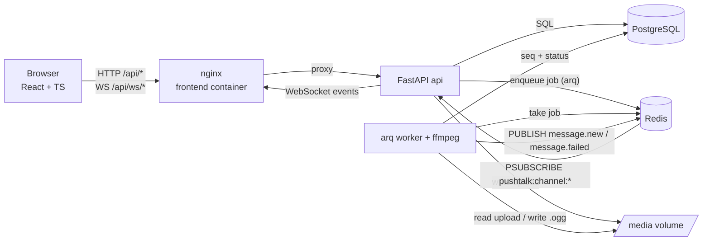

# PushTalk

Walkie-talkie style voice messaging for shared channels. Hold a button to record, release to send;
everyone else in the channel hears it automatically, one message at a time, in order.

**Stack:** Python 3.12 · FastAPI · SQLAlchemy 2 (async) · Alembic · PostgreSQL 16 · Redis 7 (pub/sub + arq job queue) ·
ffmpeg · React 19 + TypeScript · Vite · nginx · Docker Compose.

Design reasoning lives in [DECISIONS.md](DECISIONS.md), AI disclosure in [AI_USAGE.md](AI_USAGE.md), and what was
actually verified (and what was not) in [docs/VERIFICATION.md](docs/VERIFICATION.md). The long-form study guide is
[docs/PushTalk_Project_Guide.pdf](docs/PushTalk_Project_Guide.pdf).

---

## Features

| Area | What you get |
|---|---|
| Accounts | Sign up / log in with username + password (bcrypt), JWT bearer tokens |
| Channels | Create, list, join (idempotent), see members and who is **online** (live presence) |
| Recording | Hold-to-talk button (mouse, touch, **Space** key). 0.5 s minimum, auto-stop at 60 s |
| Upload | HTTP multipart, idempotent retries via `client_id`, validated server-side (size, MIME, magic bytes, **real decoded duration**) |
| Processing | Background worker (arq): ffmpeg → mono 48 kHz **Opus/OGG**, loudness-normalized, real duration, 64 waveform peaks |
| Delivery | Broadcast over Redis pub/sub → WebSocket **only after processing succeeds**; failures shown to the sender |
| Ordering | Gap-free per-channel `seq`; worker keeps upload order; client sequencer de-duplicates and fills gaps |
| Reconnect | Automatic WebSocket reconnect with exponential backoff + jitter; HTTP catch-up of missed messages |
| Playback | Sequential queue, never two at once, own messages never auto-play, paused while you record, autoplay-policy unlock, one playing tab per user |
| Status | Sender sees `Uploading → Processing → Sent → Delivered n/N → Played n/N` (or `Failed` / `Not sent` + Retry) |
| Security | Membership checks on every channel resource, protected media endpoint, no client-reported values trusted |
| Ops | JSON structured logs with request ids, consistent error envelope, env-based config, health checks, migrations |

---

## Architecture



```
 Browser ──HTTP/WS──► nginx (frontend :8080) ──► api (FastAPI :8000) ──SQL──► db (PostgreSQL)
                                                   │  ▲                          ▲
                                   enqueue (arq)   │  │ pub/sub events           │ seq, status
                                                   ▼  │                          │
                                                 redis ◄──── worker (arq + ffmpeg)
                                                                  │
                                  media volume  ◄─────────────────┘ (shared by api + worker)
```

**Message lifecycle:** record → `POST /api/channels/{id}/messages` (validated, stored, status `processing`,
job enqueued, `202`) → worker normalizes with ffmpeg, measures duration, extracts peaks → waits for older
in-flight messages of the channel → locks the channel row, assigns next `seq`, status `ready` → publishes
`message.new` on Redis → every API process forwards it to connected members → client sequencer releases it
in `seq` order → playback queue plays it → client sends `ack`/`played` → sender receives `message.status`.

### Repository layout

```
backend/
  app/
    main.py              FastAPI app factory, lifespan (Redis, arq pool, realtime hub), request-id middleware
    core/                config (env), JSON logging, error envelope, security (bcrypt/JWT), redis client
    db/                  async engine/session, declarative base with naming conventions
    models/              users, channels, channel_members, messages, message_receipts
    schemas/             Pydantic request/response models
    repositories/        data access (queries only)
    services/            business logic: auth, channels, upload validation, messages, job queue
    api/deps.py          dependency injection (session, current user, storage, queue, presence)
    api/routes/          auth, channels, messages (upload/history), media, ws, health
    realtime/            event builders + publish, Redis presence, per-process pub/sub hub
    audio/               ffmpeg/ffprobe wrappers, magic-byte sniffing
    storage/local.py     media volume storage
    worker/              arq settings + jobs (process_message, sweep_stale_messages)
  alembic/               migrations (0001_initial_schema.py)
  tests/                 pytest: auth, upload validation, worker, channels & media
  scripts/smoke_test.py  API end-to-end check against a running stack
frontend/
  src/api/               fetch client, endpoints, wire types
  src/auth/              AuthContext (session in localStorage)
  src/realtime/          ChannelSocket (reconnect/backoff/heartbeat), backoff
  src/messages/          MessageSequencer (ordering), message model (status merge)
  src/playback/          PlaybackQueue (pure logic), HtmlAudioPlayer, multi-tab leader
  src/recording/         useRecorder (MediaRecorder push-to-talk)
  src/session/           ChannelSession: orchestrates socket, history, catch-up, uploads, queue
  src/pages, components  UI
  nginx.conf             SPA + reverse proxy for /api and WebSocket
e2e/browser-e2e.mjs      Playwright test with two+ real Chromium users and fake microphones
docker-compose.yml       db, redis, migrate, api, worker, frontend
```

---

## Prerequisites

| Software | Version | Needed for |
|---|---|---|
| Docker Engine / Docker Desktop | 24+ | everything (recommended path) |
| Docker Compose plugin | v2.20+ (`docker compose`, with `depends_on.condition`) | orchestration |
| Git | any | cloning |
| Chrome (latest) | — | using the app (microphone + autoplay) |

Only for running **without** Docker: Python 3.11+, Node.js 20.19+ (22 recommended), PostgreSQL 14+, Redis 6+, ffmpeg 5+.

---

## Quick start (Docker)

```bash
git clone <repo-url> pushtalk
cd pushtalk
cp .env.example .env
# edit .env: at least set JWT_SECRET (32+ random chars) and POSTGRES_PASSWORD
python3 -c "import secrets; print(secrets.token_urlsafe(48))"   # a good JWT_SECRET

docker compose up --build
```

- Frontend: **http://localhost:8080**
- API: http://localhost:8000 (OpenAPI docs: http://localhost:8000/docs, health: http://localhost:8000/api/health)

Migrations run automatically: the one-shot `migrate` service runs `alembic upgrade head` and `api`/`worker`
start only after it succeeds. To try it, open the app in two different browsers (or one normal + one private
window), sign up two users, create a channel with one, join it with the other, hold the button and talk.

### Useful Docker commands

```bash
docker compose up --build -d          # start in background
docker compose ps                     # status + health of every service
docker compose logs -f api worker     # follow logs (JSON lines)
docker compose stop                   # stop, keep data
docker compose down                   # remove containers, keep volumes (data)
docker compose down -v                # remove containers AND volumes (full reset: DB, media, redis)
docker compose restart worker         # restart one service
docker compose run --rm migrate       # re-run migrations
docker compose exec api alembic current            # current migration revision
docker compose exec api alembic downgrade base     # roll back everything (dev only)
docker compose exec db psql -U pushtalk -d pushtalk   # SQL shell
docker compose exec redis redis-cli ping              # -> PONG
```

---

## Environment variables

All configuration is read from the environment (`backend/app/core/config.py`). `docker-compose.yml` loads `.env`
and builds `DATABASE_URL`, `TEST_DATABASE_URL`, `REDIS_URL` and `MEDIA_ROOT` for the containers.

| Variable | Default | Meaning |
|---|---|---|
| `POSTGRES_USER` / `POSTGRES_PASSWORD` / `POSTGRES_DB` | — | PostgreSQL credentials/database (Docker) |
| `DATABASE_URL` | *(required)* | SQLAlchemy URL, `postgresql+asyncpg://…` (set by compose) |
| `REDIS_URL` | `redis://localhost:6379/0` | Redis for pub/sub, presence and the job queue |
| `MEDIA_ROOT` | `/data/media` | Where uploads and processed audio are stored |
| `JWT_SECRET` | *(required, ≥32 chars)* | HMAC key for access tokens; app refuses to start without it |
| `JWT_ALGORITHM` | `HS256` | JWT signing algorithm |
| `ACCESS_TOKEN_EXPIRE_MINUTES` | `720` | Token lifetime |
| `APP_ENV` | `development` | Informational (logged at startup) |
| `LOG_LEVEL` | `INFO` | Log level |
| `CORS_ORIGINS` | `http://localhost:8080` | Comma-separated origins allowed to call the API directly |
| `FRONTEND_PORT` / `API_PORT` | `8080` / `8000` | Host ports published by compose |
| `MAX_UPLOAD_BYTES` | `5242880` | Max upload size (5 MB) |
| `MIN_AUDIO_SECONDS` / `MAX_AUDIO_SECONDS` | `0.5` / `60` | Duration limits (checked on the decoded audio) |
| `DURATION_TOLERANCE_SECONDS` | `0.5` | Accepted overshoot above 60 s at upload; the worker trims output to exactly 60 s |
| `WAVEFORM_PEAKS` | `64` | Number of waveform bars computed per message |
| `FFMPEG_TIMEOUT_SECONDS` | `30` | Hard timeout for every ffmpeg/ffprobe call |
| `ORDERING_WAIT_SECONDS` | `20` | Max time a job waits for older in-flight messages before publishing |
| `PROCESSING_STALE_SECONDS` | `120` | Messages stuck in `processing` longer than this are marked failed |
| `WORKER_MAX_JOBS` | `4` | Concurrent jobs per worker process |
| `WS_AUTH_TIMEOUT_SECONDS` | `5` | Time allowed for the WebSocket `hello` frame |
| `PRESENCE_TTL_SECONDS` | `45` | Presence entry lifetime; also the WebSocket idle timeout |

Frontend build-time (optional): `VITE_API_URL` (default `/api`), `VITE_WS_URL` (default: same host `/api`),
`VITE_BACKEND_URL` (dev-server proxy target, default `http://localhost:8000`).

---

## API overview

All errors share one shape: `{"error": {"code": "…", "message": "…", "details": …, "request_id": "…"}}`.

| Method & path | Auth | Purpose |
|---|---|---|
| `POST /api/auth/register` | – | Create account → `201 {access_token, user}` |
| `POST /api/auth/login` | – | Log in → `200 {access_token, user}` |
| `GET /api/auth/me` | Bearer | Current user |
| `GET /api/channels` | Bearer | All channels with `member_count`, `is_member` |
| `POST /api/channels` | Bearer | Create channel (creator joins) → `201` |
| `POST /api/channels/{id}/join` | Bearer | Join (idempotent) |
| `GET /api/channels/{id}/members` | Member | Members with `online` flag |
| `GET /api/channels/{id}/messages?after_seq=&before_seq=&limit=` | Member | History / catch-up (ascending `seq`) |
| `POST /api/channels/{id}/messages` (multipart `file`, `client_id`) | Member | Upload → `202` (`200` for a duplicate `client_id`) |
| `GET /api/messages/{id}/audio` | Member of the message's channel | Processed `audio/ogg` |
| `GET /api/health` | – | DB + Redis check (`503` when degraded) |
| `WS /api/ws/channels/{id}` | `hello` frame with JWT + membership | Realtime events |

WebSocket protocol — client → server: `hello`, `ping`, `ack {delivered: [ids]}`, `played {message_id}`.
Server → client: `ready {latest_seq, online}`, `message.new`, `message.failed`, `message.status`, `presence`,
`resync`, `pong`, `error`. Close codes `4400/4401/4403/4404` are final; `1011/1013/4408` mean "reconnect".

---

## Running tests

```bash
# Backend (inside Docker; uses the <POSTGRES_DB>_test database created on first DB start)
docker compose run --rm api pytest -q

# Frontend unit tests (playback queue, sequencer, socket reconnect, message model)
cd frontend && npm ci && npm test

# API smoke test against the running stack (auth, channels, pipeline, ordering, catch-up, security)
docker compose exec api python scripts/smoke_test.py

# Browser end-to-end test against the running stack (needs Node 20+ on the host)
cd e2e && npm install && npx playwright install chromium
BASE_URL=http://localhost:8080 node browser-e2e.mjs
```

If your database volume was created before the test database existed, create it once:
`docker compose exec db createdb -U pushtalk pushtalk_test`.

---

## Local development without Docker

```bash
# 1. Services: PostgreSQL, Redis and ffmpeg installed locally
createdb pushtalk && createdb pushtalk_test

# 2. Backend
cd backend
python3 -m venv .venv && . .venv/bin/activate
pip install -r requirements-dev.txt
export DATABASE_URL=postgresql+asyncpg://<user>:<pass>@localhost:5432/pushtalk
export TEST_DATABASE_URL=postgresql+asyncpg://<user>:<pass>@localhost:5432/pushtalk_test
export REDIS_URL=redis://localhost:6379/0 MEDIA_ROOT=./media JWT_SECRET=$(python3 -c "import secrets;print(secrets.token_urlsafe(48))")
alembic upgrade head
uvicorn app.main:app --reload --port 8000        # terminal 1
arq app.worker.main.WorkerSettings               # terminal 2 (same env vars)
pytest -q                                        # tests

# 3. Frontend (terminal 3) — Vite proxies /api and the WebSocket to :8000
cd frontend && npm install && npm run dev        # http://localhost:5173
```

---

## Troubleshooting

| Symptom | Likely cause | Fix |
|---|---|---|
| `Cannot connect to the Docker daemon` | Docker not running | Start Docker Desktop / `sudo systemctl start docker` |
| `port is already allocated` | 8080/8000 in use | Change `FRONTEND_PORT` / `API_PORT` in `.env` |
| api exits with `JWT_SECRET … at least 32 characters` | Missing/short secret | Set a long `JWT_SECRET` in `.env` |
| `migrate` fails, `password authentication failed` | `.env` password changed after the DB volume was created | `docker compose down -v` (resets data) or use the old password |
| Messages stay "Processing…" | Worker down or crash-looping | `docker compose ps worker`, `docker compose logs worker`. Queued jobs run when the worker is back; messages stuck > 120 s are then marked failed by its sweeper |
| "Reconnecting…" forever | API down, Redis down, or proxy not forwarding WebSocket upgrades | `docker compose ps`, `curl localhost:8000/api/health`, check nginx config |
| "Click to enable auto-play" banner | Browser autoplay policy (no user gesture yet) | Click anywhere / the banner; messages wait in the queue |
| Microphone error | Permission denied, no device, or non-secure origin | Allow the mic; use `http://localhost` or HTTPS (not a LAN IP over http) |
| Upload rejected `AUDIO_TOO_SHORT` | Released too early | Hold ≥ 0.5 s |
| Backend tests fail to connect | `pushtalk_test` DB missing | `docker compose exec db createdb -U pushtalk pushtalk_test` |

---

## Known limitations

- **Docker images were not built in the authoring environment** (its network policy blocked Docker Hub). The compose
  file was validated with `docker compose config`, the nginx config was run with a local nginx, and every service was
  run natively with the same commands the containers use. See [docs/VERIFICATION.md](docs/VERIFICATION.md).
- Tested in Chromium (latest) only. Firefox (records Ogg/Opus) and Safari (records MP4/AAC) are accepted by the backend
  but were not tested; Safari lacks `navigator.userActivation`, so the first auto-play relies on the `play()` rejection path.
- No refresh tokens or server-side token revocation; the JWT lives in `localStorage` (XSS would expose it).
- No rate limiting (stretch goal, not implemented). No leaving/deleting channels, no DMs, no transcription, no playback speed.
- The UI loads the latest 50 messages; the API supports older pages (`before_seq`) but there is no "load older" button.
- Receipt totals use the *current* member count, so a member who joins later is counted as a recipient of older messages.
- Media is on a local Docker volume shared by api and worker: single host only (swap in MinIO/S3 to scale out).
- If Redis goes away, the arq worker process exits and relies on Docker's `restart: unless-stopped`.
- Auto-play of catch-up messages uses a 5-minute age window measured with the client clock (clock skew shifts it).
- The microphone stays open while a channel page is open (instant push-to-talk; the browser shows the mic indicator).
